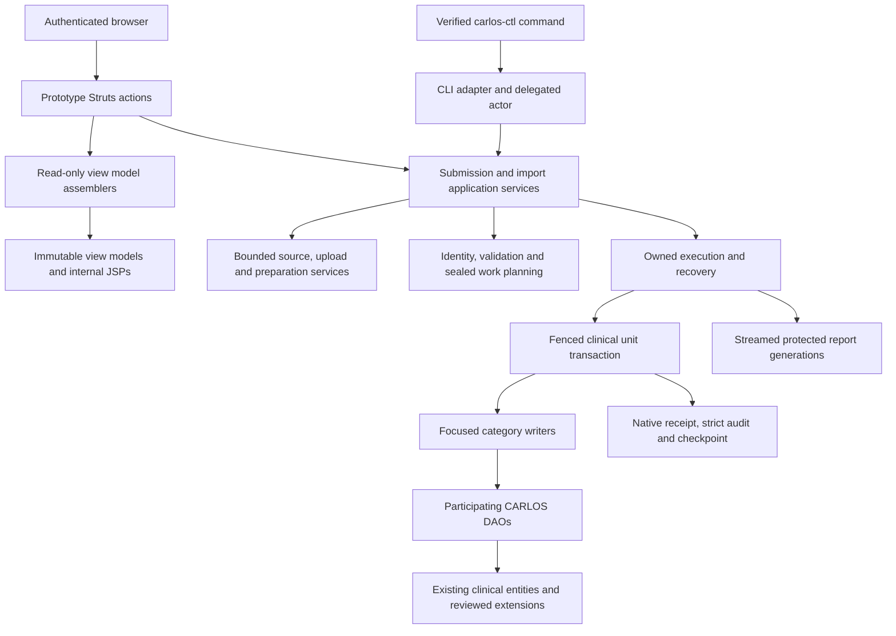

# CDS import architecture and framework integration

This document maps the import implementation to CARLOS's [Ontario billing architecture](billing-ontario-module.md) and [layer naming policy](architecture/layer-names.md). Use the [documentation index](cds-import.md) for the operating and clinical contracts. The [final review](cds-import-final-review.md) records the last independent review and focused refactor decisions.

## Responsibilities and dependency direction

The adapters enforce transport and authentication contracts. Application services own multi-step use cases. DAO methods access their entity's persistence boundary; services coordinate across DAOs. Normalization produces immutable decisions before native mutation. Views receive bounded presentation values, rather than managed entities, servlet state or source documents.

The importer uses the application's JPA entity manager and transaction manager. It does not introduce a second ORM, independent clinical database or generic vendor-object copier. New import entities represent durable work, provenance and reviewed source meaning that legacy projections cannot fully express.

## Class and package map

The module lives under `io.github.carlos_emr.carlos.demographic.cdsimport`.

| Package or component | Responsibility | Boundary |
| --- | --- | --- |
| `web/*2Action` | Method/version/parameter gates, native authorization, typed binding and HTTP result formatting | Prototype instances; no source parsing or clinical transaction ownership |
| `assembler/*ViewModelAssembler` | Read-only composition for one JSP | Bounded immutable output; no durable state changes |
| `viewmodel/*ViewModel` | Explicit render data | No managed clinical graph or physical file locator |
| `command/*Command` | Typed use-case input | Opaque IDs and reviewed options; no caller-selected server paths |
| `dto/*Dto` | Typed persistence, preparation and query boundaries | Finite data and opaque references; no request lifetime |
| `CdsUploadSubmissionService` | Coordinate an owned browser upload into one authorized submission | Resolve the immutable source without preclaiming acceptance; delegate durable acceptance |
| `CdsImportService` | Shared authorized import, recovery, status and dispatch API | Browser and CLI use the same engine |
| `CdsImportJobService` | Durable accepted request, source identity and immutable job document | Sole locked acceptance claim/acknowledgment path |
| `CdsUploadService` | Transfer receipts, chunk verification, quota and upload lifecycle | Byte transfer outside database transactions; short durable state transitions |
| `CdsImportPlanningService` | Source discovery, validation, identities, dependencies and expected work | Stream/spool; freeze the workset before clinical writes |
| `CdsNativePreparationService` and category preparation | Hash-bound native candidates and private prepared values | File I/O and semantic decisions outside the clinical write transaction |
| `CdsImportExecutionService` | Bounded execution, receipt verification, interruption recovery and finalization | Explicit physical ownership and epoch |
| `CdsImportUnitService` | Own one clinical transaction | Native rows, references, receipt, strict event and checkpoint commit together |
| Category `*Persister` / `*ImportService` | Persist one reviewed category occurrence | Join the unit transaction through participating DAO operations |
| `CdsImportLedgerService` and import DAOs | Run, patient, workset, lineage and recovery state | Versioned, locked and bounded operations |
| `CdsImportObservationService` | Protected current read model | Authorization before aggregates; read-only transaction; bounded projections |
| `CdsImportReviewService` | Versioned correction/decline/revalidation publication | Immutable original source; explicit compare-and-set and eligibility proofs |
| `CdsImportFileService` / publication services | Immutable source/native file generations and references | Proved ownership, publication and adoption; no filesystem/DB pseudo-atomicity |
| `CdsImportResultService` / `CdsImportReportService` | Generate, select and serve protected reports | Bounded streams, immutable generations and fenced selection |
| `CdsImportCleanupService` | Reconcile ownership and retire eligible private artifacts | Accepted, uncertain, shared and resumable evidence remains retained |
| `CdsImportAccessService` | Current actor, category, patient and execution scope | Database rights are rechecked; a captured actor is not a durable permission grant |
| `CdsImportMaintenanceService` and JDBC support | Drain ordinary writers and hold physical ownership | Dedicated connection lifetime, guard participation and explicit release |

Existing clinical entities and DAOs remain in their established persistence packages. See the [per-category data-access contract](cds-clinical-import-contract.md#data-access-and-framework-integration) for the concrete DAO list and the reasons some ordinary UI operations are unsuitable for migration.

## Browser jobs and foreground commands

The browser transfers bounded hashed chunks and receives an owned upload ID. Typed submission options become one durable accepted run. Once accepted, the job continues independently of the browser tab. A bookmark and owned upload history locate the same run after login or reconnect.

`CdsImportService` uses one worker and a queue of sixteen tasks per application context. Its dispatcher periodically queries bounded durable pending work. The queue improves scheduling; the database remains the work and recovery authority. A full queue or process restart does not erase a durable accepted job or resume request. Physical coordinator ownership excludes overlapping execution across contexts/nodes.

The foreground CLI prints the durable accepted handle before long execution. The installed command reconstructs the explicit delegated actor and uses the same application services. It has a dedicated bounded context and connection pool; it does not start the complete web application's background workload. Browser and CLI normalization, checkpoints and report semantics remain shared.

Protected job observations separate database lookup, file access and fresh authorization. A bounded scalar binding prefetch belongs in the existing run DAO with explicit `SUPPORTS`, read-only semantics; its service boundary refuses an ambient transaction. It returns an immutable value object rather than a managed run entity. File reading and hashing occur after that lookup scope ends. The subsequent read-only observation transaction rechecks current binding and authorization, and uses its existing managed run for bounded aggregates. The preliminary snapshot never replaces those current checks. See R5 in the final review for the required actual Spring/JPA resource-lifecycle proof.

## Source and transaction lifecycle

1. **Transfer or preaccept source preservation.** Validate ownership, limits and immutable options. Stream original bytes into protected owned storage. Retain uncertain acceptance rather than guessing rollback.
2. **Durable acceptance.** Resolve the existing submission identity or publish the accepted job document under the acceptance locks. Claim and acknowledgment belong to this application boundary.
3. **Discovery and planning.** Identify all source files and patient occurrences, validate the pinned XML/profile, prepare bounded records, resolve identities and build native/helper dependencies.
4. **Seal.** Freeze exact patient/copy/unit keys, source digests and dependencies. Unknown inventory becomes known only when this proof succeeds.
5. **Prepare native work.** Validate current policy and prepare native DTOs and file publication outside the clinical write transaction.
6. **Commit one unit.** Acquire current admission/run/epoch/unit/lineage locks, validate dependencies and current access, persist through the category writer, verify receipt data, and atomically commit native effects, evidence, event and checkpoint.
7. **Finalize a patient.** Reconcile exact sealed keys, row receipts and file dependencies before publishing its outcome and releasing its hold.
8. **Release and report.** Verify maintenance release when eligible, create immutable report files, reconcile cleanup and select one authoritative report generation. Report delivery remains distinct from clinical completion.

No transaction spans an entire source package or patient chart. A native unit can succeed before a later unit fails. The ledger records that partial truth and holds the affected incomplete chart until supported recovery proves its workset.

## Ownership and uncertain acknowledgments

The coordinator's dedicated advisory connection proves exclusive execution. Database owner epochs fence prior workers; chart holds protect incomplete clinical publication. A heartbeat or elapsed timeout is insufficient permission to take over.

The unit's explicit transaction owns commit acknowledgment. A lost acknowledgment can leave a committed native receipt and checkpoint. Recovery verifies those durable facts and the current physical target before skipping work. A failed command is not proof of rollback, and changing a namespace is not an idempotency strategy.

Administrative resume is a durable request. Pending recovery affects terminality even when reports from a previous attempt are available.

Each immutable completion receipt projects delivery of its own selected report generation using the fresh completion-time ledger state. A pending Resume observed in that snapshot keeps `cleanComplete=false` and `operationTerminal=false`. Requests accepted after that snapshot belong to later live status; an immutable prior receipt is historical evidence and is not rewritten. These receipt predicates use the base ledger summary. The operator facade additionally suppresses terminality for ordinary unresolved review work; use live protected status to decide whether further operator action is pending.

## Normalization and the existing model

Clinical mapping is explicit by category. Original source, logical corrections, source precision, author identity, consent and authority are independent facts. The importer validates against CARLOS's real storage and reader constraints before calling a writer; database enforcement still applies at the unit boundary.

The writer composes a suitable existing DAO operation. It avoids ordinary UI manager behavior that can sign notes, reorder pharmacy relationships, create additional revisions, deduplicate a distinct occurrence, send outbound messages or independently commit. A narrow participating operation on an existing DAO is preferable when those ordinary side effects conflict with the reviewed migration contract.

For example, `DemographicDao.persistImportedDemographic` inserts a new historical patient in the caller's transaction, retaining entity lifecycle callbacks while excluding registration events/A04 output. Existing note persistence preserves explicitly supplied UUIDs and dates. HL7 message persistence remains insert-only. Related native identifiers are checked before receipt construction.

Some reads deliberately use bounded current projections because ordinary APIs cache membership, eagerly load directory graphs or apply incomplete identity predicates. These exceptions preserve CARLOS's mapped entities and semantics. They do not authorize unbounded lists or cached authorization. See the clinical contract and the independent final review for the evaluated alternatives.

## Memory, I/O and backpressure

| Area | Mechanism |
| --- | --- |
| XML and binary payloads | Streaming parser/validation and bounded Base64/file buffers; private disk spools instead of a whole-document object graph |
| Planning and grouping | Bounded pages and disk-backed occurrence/work metadata; complete sealed inventory |
| ORM | Short unit transactions and explicit lifecycle boundaries; no batch-sized retained entity graph |
| Native narratives | Bounded native projections with visible lossless source access when a target cannot carry the full value |
| Job metadata | Bounded hash-named immutable document; validation outside the clinical write transaction |
| Source-field work | Bounded helper pages; clinical occurrence totals remain separate |
| Worker scheduling | One worker, bounded queue, durable database rediscovery |
| Operator status | Finite aggregate groups and immutable projections; large complete evidence stays in streamed reports |
| Browser | Bounded chunks, bounded decoded status responses and paged render data |
| Native receipts | Server-side length/hash projection rather than materializing large native values |
| Filesystem storage | Reservations, inode/free-space admission and ownership-aware publication/retention |

Physical I/O controls check local interruption and stage/attempt budgets on bounded reads. Fresh physical ownership/control probes remain bounded in time and are forced at critical boundaries. Query optimization must preserve these checks, current permissions and all receipt hashes.

The [resource verification contract](cds-import-performance.md) defines the measured heap, RSS, cgroup, SQL, time and storage gates. A heap flag alone does not establish total memory use, and a CI throughput observation does not predict upload time or every production workload.

## Security and presentation

Import administration and clinical source access are distinct scopes. Web routes use native sessions, method/version/CSRF checks and current role/provider/facility/program rules. Clinical source pages additionally check the requested patient, category, import hold and sensitivity restrictions. CLI operations require the independently verified root-owned delegation boundary.

Internal JSPs render encoded immutable view models. Browser code uses text-safe rendering and opaque IDs. Public errors carry stable codes and bounded technical classification; patient values, SQL, exception messages and physical paths are excluded from ordinary technical output. Complete clinical details remain in the authorized protected reports/source views.

## Implementation compatibility

The ruleset binds the actual implementation, including the finite native model/DAO dependencies, runtime and normalization policy. Module class families and reviewed ordinary dependencies are included. A changed delegated DAO operation must change compatibility identity, even if the importing service's source did not change.

Packaging additionally binds actual class files, dependency JARs, migration resources and relevant application resources. Resource-test and installed WAR hashes are recorded separately. If their raw hashes differ, a complete entry-level comparison and reviewed explanation are required; matching source IDs or class/JAR counts alone cannot prove byte parity.

## Developer change checklist

- Put HTTP adaptation in actions, read-only render composition in assemblers, cross-DAO workflows in application services and entity operations in suitable DAOs.
- Keep commands, DTOs and prepared work bounded. Preserve explicit ownership of streams, locks, transactions and published files.
- Evaluate the existing DAO's actual callbacks, cache, propagation, audit and external side effects before reuse.
- Extend existing DAOs narrowly when their ordinary API cannot preserve required import semantics; keep ordinary callers' established contracts.
- Preserve source meaning and every disposition. Propagate failures that require rollback; report unknown acknowledgments explicitly.
- Add meaningful regressions for state transitions, races, malformed data and resource boundaries. Keep required CDS tests in CI.
- Update the relevant Markdown contracts and specification/source pins when their covered implementation changes.
- Record final exact-artifact evidence before release acceptance; retain historical failures and pending gates honestly.
