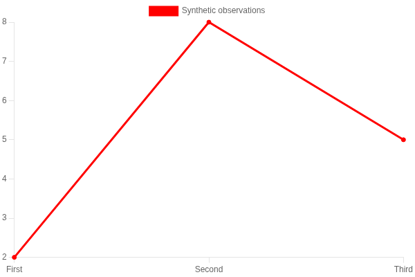
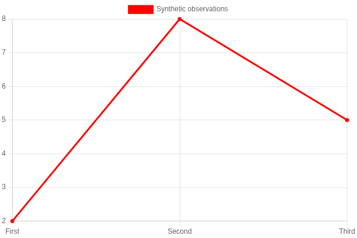
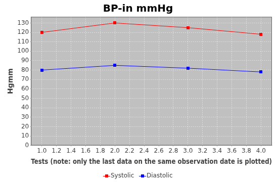

# Dependency replacements for #5472

The WAR no longer carries POI, JFreeChart, Selenium or displaytag. The WAR packaging check
(`scripts/check-war-container-apis.py`) verifies container API and JSTL boundaries. POI is a test-only independent
reader for the spreadsheet round trips. The JSTL API is declared directly, because Tomcat
does not supply it; the existing WAR packaging check also requires the API and implementation.

## Output and deployment differences requiring review

* Report-by-template and clinical exports now download `oscarReport.xlsx`, with the OOXML
  content type. The existing `getXLS` request parameter remains supported. The small JDK ZIP/XML
  writer keeps string cells (including identifiers, Unicode and formula-looking text) separate
  from numeric cells. Report-by-template retains its conservative numeric conversion; clinical
  export retains its existing numeric conversion. CSV is unchanged.
* The release branch's direct Dx Research XLSX export also uses the JDK writer. It retains
  its sheet name, eleven string columns, frozen header and 22-character column widths.
  Rows are serialized one at a time, without adding a runtime POI dependency.
* Measurement endpoints still return PNG/JPEG at their existing dimensions (JPEG at full quality,
  as `ChartUtils.writeChartAsJPEG(..., 1.0f, ...)` wrote it), so image, print and document callers
  keep working. The draw script reproduces the JFreeChart charts: the "JFree" theme and the plain
  `new JFreeChart` look of the combined medication charts, the series paint sequence and
  `DefaultDrawingSupplier`'s shape sequence (a square, then a circle: blood pressure's second
  series), JFreeChart's auto ranges (margins of the data's own span, the include-zero, sticky-zero
  and minimum-size rules, the symbol axis), its 1-2-5 number units with `NumberTickUnitSource`'s
  label formats (`0.0` to `0.0000`, `#,##0`, and `#.######E0` outside 1e-4 to 5e6) and its standard
  date units from milliseconds to centuries with their formats (`HH:mm:ss.SSS` to `yyyy`), chosen
  by its two-pass label-size estimate in Java's own integer glyph advances for the bundled DejaVu
  Sans and anchored as `DateAxis.previousStandardDate` anchors them. The layout matches
  JFreeChart's: the 4px axis offset with the axis lines and tick marks drawn in it, tick and axis
  label insets, label space sized in Java's metrics with edge labels overhanging the plot, the
  title centred on the image, and the legend's `FlowArrangement` (one centred row, or rows from the
  left edge once it wraps, items padded 2px with 14px line or shape-width graphics and outlined
  markers). Text is drawn as Java2D drew it: Latin-1 labels glyph by glyph at Java's integer
  advances (Chromium's fractional spacing ran a long medication name into the next legend
  marker), and vertical-axis labels centred on Java's baseline rather than the canvas "middle".
  Every plot rectangle lies within 2px of the data area JFreeChart recorded. 1px lines,
  6x6 markers filled and outlined in their series paint (7px), item labels (`DecimalFormat` without grouping, on the first series only), high-low
  range bars, flat bars with their 4px gray shadow painted bar by bar (a repeat prescription's
  shadow edge still crosses an earlier bar on its row), and a combined chart's equal subplot slots
  with the measurement plot's own 4px offset complete it. A medication request that matches no
  prescription keeps the former empty "Meds" panel. `MeasurementChart` describes each chart's
  look as the former action configured it (margins, zero, plot background, gridlines, shapes,
  item-label rules by tens of points, or sixes beside medications, green or sequence-coloured
  reference ranges). `scripts/fixtures/chart/jfreechart` holds recordings made with JFreeChart
  1.5.6 from the former code paths, including a single reading's two-millisecond axis,
  scientific and grouped tick labels, blood pressure on the lab chart, an empty medication
  chart and a medication prescribed again inside an earlier prescription; `scripts/chart-draw-playwright-checks.js` requires the same ranges, ticks, labels,
  colours, fonts, legend, bar geometry and plot rectangles. Pixel checks also require visible
  dashed gridlines on both axes wherever a recorded tick falls inside the plot. Kept as they
  were, because this change replaces the library and not the charts: the reference range chart's
  "HighLowChartDemo2" title and "DREFERENCE RANGE" legend entry, the `rxincl` chart's
  "MED + LAB CHART" title, and the green value axis of `labRef` when ranges exist. Deliberate
  departures, all on routes no CARLOS page links to except the last: `labRef` drew that green axis
  twice (one axis object at two indices) and it is drawn once here; `inclRef` and `labRef` now
  draw the reference ranges stored as `minimum`/`maximum` measurement extensions, which the former
  lookup (by the extension's own id) never found, and a malformed stored bound leaves its range out
  rather than failing the image; the obsolete `rxincl` example overlay with hardcoded 2007–2009
  drugs is replaced by the selected patient's medication intervals; and the lab-plus-medication
  chart plots LOINC observations from their observed timestamps, which the former chart read from
  a field LOINC values never carried (it showed an empty lab panel). Series values, daily
  replacement semantics, separate blood-pressure series, reference bounds, secondary axes and
  medication intervals (one row per DIN, named by its first prescription) are represented
  explicitly.
* Chart rendering now needs the already-running local browser service, like eForm PDF rendering.
  Charts and eForm PDFs share the two-browser limit; a chart request queues for a slot for the
  renderer's slot wait (up to sixteen waiting at once) before reporting the renderer busy, and the
  bundled Chart.js and draw script (`library/chartjs/carlos-chart-draw.js`) are read from the WAR
  once. The measurement graph action answers HTTP 503 with no image when the renderer is
  unavailable, like the scatter servlet. With no readings to plot, the scatter servlet answers
  204 No Content where release/2026.08 sent an empty 200; neither carried an image, and no CARLOS
  page links the servlet. A medication-only chart (ChartMeds) is the single
  medication panel of the former combined plot, with long product names shortened on its axis
  as before and a prescription that starts and ends the same day drawn as a one pixel line with
  its shadow, as JFreeChart drew it. The devcontainer installs and starts the matching
  chromedriver (`server start`), so graphs and eForm PDFs render there without setup.
* Former displaytag tables use encoded JSTL rows (`${carlos:forHtml(...)}`), with the shared
  assets included once per rendered page (`CarlosTableAssetsJspRegressionTest`). Pages whose
  backing attribute was a lone placeholder bean under displaytag (the Disease Registry results)
  now seed an empty list, since `<c:forEach>` iterates collections only; the empty results table
  therefore reads "No data available in table" instead of the placeholder's blank row counted as
  "1 of 1 entries". The Satellite-sites and Referral Doctors tables show their column names: under
  displaytag those headers were `title="<fmt:message .../>"` attributes, which JSP never evaluates,
  so release/2026.08 printed the raw tag and the header row came out blank. An empty list renders
  only its message, not a header row (`JstlTableEmptyStateJspRegressionTest`), as displaytag did. Sorting and paging run locally, with typed
  numeric/date keys and case/accent-insensitive text collation, numbered pages and keyboard
  controls. Without JavaScript all rows remain readable; sort controls are added only when the enhancement script runs. Sorting no longer navigates or repeats
  search parameters, CSRF tokens or rejected form values into URLs. Existing row actions remain
  in the JSPs, including billing edit/delete and referral labels.
  Disease registry results retain their existing DataTables search and sorting, with
  DataTables as their sole enhancer and all matching rows on one page.

These changes are proposed for review; #5472 requires sign-off on output differences before
merging. A byte-identical XLS or chart image is not claimed.

## Browser transport

`RenderBrowser` sends the renderer's existing W3C navigation, script, timeout and log commands
with the JDK HTTP client. CDP commands still cross chromedriver's private pipe to Chromium.
The service is loopback-only, redirects are refused, inherited outbound proxies are not used
for that local control channel, and capability prefixes remain part of every request path.
The existing launch flags, network/completeness gates, native print parameters, concurrency
limits and cleanup backstop remain active. Browser error replies are not copied into errors: a
failed command reports its HTTP status and W3C error code (only codes from the fixed W3C and
chromedriver vocabulary; anything else reads `unrecognized`). Session creation, which runs before
any patient page is loaded, also carries chromedriver's message, URL/path-redacted, on one line and
truncated, so a version mismatch, missing binary or sandbox crash is diagnosable from the log. Session
teardown and its force-delete backstop clear a pending thread interrupt for their one bounded DELETE
and restore it afterwards, so an interrupted render still ends its browser.

## Reproduction

Run in Ubuntu 26.04 with Java 25, Maven, the packaging Build-Depends and a matching
chromedriver/Chromium pair:

```sh
mvn test
mvn -Pjspc -DskipTests package
python3 scripts/check-war-container-apis.py target/carlos-*.war
# Either let the suites start and stop the driver binary on a free loopback port ...
CARLOS_SMOKE_CHROMEDRIVER=/path/to/chromedriver \
CARLOS_SMOKE_CHROMIUM=/path/to/chrome \
mvn test -Dtest=EFormBrowserPdfServiceSeleniumSmokeIntegrationTest,MeasurementChartSmokeIntegrationTest
# ... or point them at a chromedriver that is already running.
CARLOS_SMOKE_DRIVER_URL=http://127.0.0.1:9515 \
CARLOS_SMOKE_CHROMIUM=/path/to/chrome \
mvn test -Dtest=EFormBrowserPdfServiceSeleniumSmokeIntegrationTest,MeasurementChartSmokeIntegrationTest
CARLOS_SMOKE_CHROMIUM=/path/to/chrome npm run test:dependency-tables-playwright
CHART_SCREENSHOT_DIR=target/chart-fixtures \
CARLOS_SMOKE_CHROMIUM=/path/to/chrome npm run test:chart-draw-playwright
```

The PDF/chart browser smoke suites are opt-in: they need the browser binary and either a driver
binary (`CARLOS_SMOKE_CHROMEDRIVER`) or a running driver (`CARLOS_SMOKE_DRIVER_URL`, which wins when
both are set). Without a driver they skip; a configured driver that does not start fails. The
release plan's `java-browser-pdf` lane runs both suites with `CARLOS_SMOKE_CHROMIUM` and
`CARLOS_SMOKE_CHROMEDRIVER`, and `java-all` routes their skips to that lane. The legacy Selenium smoke
class name remains for operator command compatibility.

The standalone table and chart-draw Playwright checks require only Chromium; they load static DOM fixtures and the bundled scripts without network navigation or a driver service. Both now run in the Script Regressions workflow. Its `chart-fixtures` artifact preserves each synthetic chart before assertions, including the failing image. The deployed checks `report-by-template`, `export-content-rbt-columns` and `el-jstl-pages` read the `.xlsx` export and the JSTL tables.

The PDF tests assert authored pagination and a real text layer. The chart smoke checks real
PNG/JPEG rendering with clinical series, reference bounds and medication intervals. Playwright
checks default sorting, typed keys, paging, keyboard operation and row actions without form
submission. The JSP profile compiles the actual application pages.

Regression coverage also checks overlapping literal OOXML escape sequences, duplicate scatter
observations, medication names with identical shortened labels, empty medication charts, and
large constant measurement values. Reference ranges load both bounds by measurement ID, and
lab-plus-medication charts accept the LOINC provider's collection-date field. Invalid range data
or a failed chart draw produces an explicit error before image bytes are sent. Empty migrated
tables retain their localized messages, including staff tables with nested team markup.

Corrected grid screenshots rendered directly in Chromium from the synthetic chart fixtures:

* [Measurement graph](images/pr5518/grid-fixed-default.png)
* [Scatter plot](images/pr5518/grid-fixed-scatter.png)
* [Medication intervals](images/pr5518/grid-fixed-chartmeds.png)

These captures supersede the chart grid appearance in the earlier PR screenshot gallery.
The medication capture uses the two-medication fixture (including a one-day interval) with a
synthetic patient title; it is a chart fixture, not a capture of a deployed patient page.

## Shared bundle and marker review

The shared Chart.js 4.5.1 bundle had eight damaged property names, including
`drawOnChartAre` instead of `drawOnChartArea`. The image adapter's explicit grid setting
hid this defect, while native charts using the defaults still lost their grids. The bundle
now matches the published npm and jsDelivr artifact byte for byte; its
[provenance and SHA-256](../src/main/webapp/library/chartjs/README.md) are recorded alongside it.
A Node integrity check protects the vendored bytes. Browser pixel checks require both axes
on native line/bar charts as well as the 13 JFreeChart compatibility fixtures. Disabling
either axis in copies of the native and adapter checks was verified to fail all four checks.

These native line captures use the same synthetic input with the old and restored bundle:

| Before: missing default grids | After: restored default grids |
| --- | --- |
|  |  |

Visual comparison also found that diastolic blood pressure's circular markers had become
squares. The adapter now preserves the circle in both the plot and legend. The reference
generator records shape type as well as bounds; marker pixel checks reject the old square.

| JFreeChart reference | Replacement before correction | Corrected replacement |
| --- | --- | --- |
|  |  |  |

This review used an Ubuntu 26.04 container, OpenJDK 25, Node 22 and a matching Chrome for
Testing 149.0.7827.55 / chromedriver pair. Browser inputs and screenshots are synthetic;
release browser pins are unchanged.
