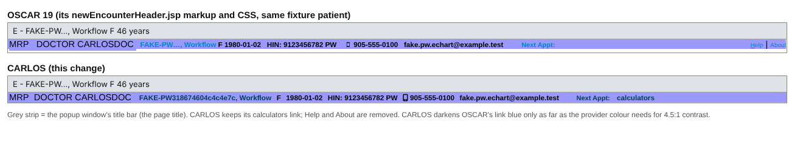
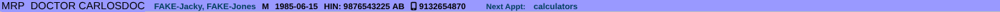
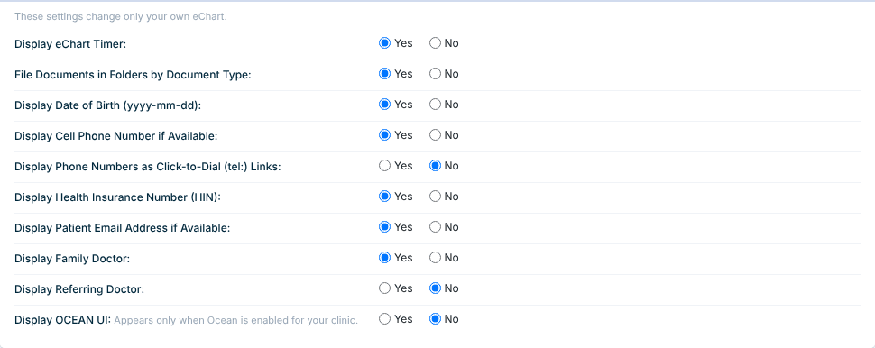
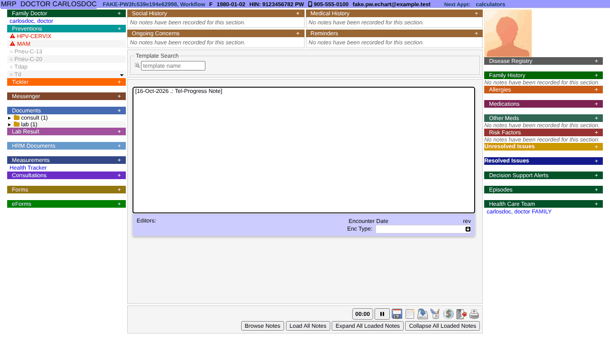
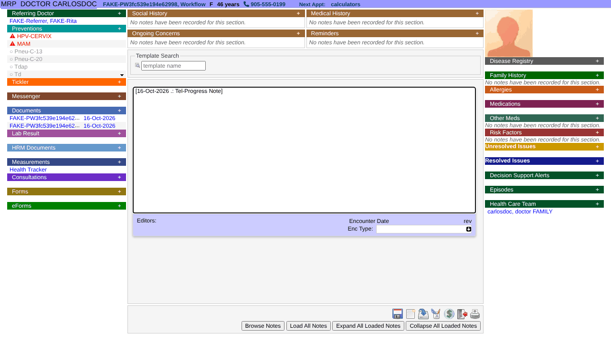

# eChart display preferences

Each provider chooses what their own eChart shows, in **Preferences > eChart** (the schedule's
"Edit your personal setting" icon). The settings and the header bar they drive follow OSCAR 19's
eChart Display Settings, so a clinic moving from OSCAR 19 sees the same chart. In OSCAR 19 these
were clinic-wide (Administration > eChart > eChart Display Settings); in CARLOS they are personal.
CARLOS adds one setting OSCAR 19 did not have: click-to-dial phone links (issue #852).

| Setting | Default | What it changes |
|---|---|---|
| Display eChart Timer | Yes | The timer button in the note panel (click pastes start, end and elapsed time into the note; it turns green at 20 minutes and yellow at 50). |
| File Documents in Folders by Document Type | Yes | The left-column Documents panel lists one collapsed folder per document type ("consult (2)", "lab (1)", ...) instead of a list by date. Documents without a type go in "Other". |
| Display Date of Birth (yyyy-mm-dd) | Yes | The header bar shows the date of birth with the age as its tooltip; No shows the age with the date of birth as its tooltip. |
| Display Cell Phone Number if Available | Yes | The header bar shows the cell number (home number in the tooltip); No, or no cell on file, shows the home number, with the cell (if any) still in its tooltip as OSCAR 19 had it. A number the patient marked preferred (trailing `*`) is always shown instead. |
| Display Phone Numbers as Click-to-Dial (tel:) Links | No | Each phone number in the header bar is a `tel:` link, so a click dials it through the workstation's softphone or calling app (whatever handles `tel:` links there) instead of copying it. The link dials the digits only, keeps a leading `+`, and passes an extension typed as `x123`, `ext 123`, `ext: 123`, `extension 123` or `#123` as `;ext=123`. The tooltip is unchanged. |
| Display Health Insurance Number (HIN) | Yes | The HIN and version code in the header bar. |
| Display Patient Email Address if Available | Yes | The email address in the header bar; a mailto link when the patient consented to email for care. |
| Display Family Doctor | Yes | A Family Doctor panel at the top of the left column: the patient's "Family Doctor" professional contact (Health Care Team), else the legacy family-doctor field. |
| Display Referring Doctor | No | A Referring Doctor panel at the top of the left column: the master record's Referral Doctor, else a "Referring Doctor" professional contact. |
| Display OCEAN UI | No | The Ocean toolbar placeholder. Ocean must also be enabled for the clinic: `cme_js=ocean` in `carlos.properties`, and Administration > eChart > eChart Display Settings left on. |

## The chart window title and the header bar

As in OSCAR 19, the chart window's title bar names the patient: `E - LAST, FIRST SEX AGE`
(for example `E - FAKE-Jacky, FAKE-Jones M 41 years`), so several open charts can be told apart in
the taskbar.

The header bar is OSCAR 19's single line in the viewer's provider colour (Preferences > Set Provider
Colour; light blue when never chosen), styled as OSCAR 19 styled it: "MRP  DOCTOR NAME" in the larger
plain font, underlined in the MRP's own colour, then the patient's details in smaller bold text: the
name (a link that opens the Master Record), sex, date of birth or age, HIN, phone, email,
and "Next Appt: <date>" (blank when nothing is booked; opens the appointment history). CARLOS keeps
its clinical calculators link and any configured chart links after them; there are no Help or About
links. Date of birth or age, HIN, phone and email are buttons that copy the value to the clipboard.

Links use OSCAR 19's blue (`#0088CC`), darkened in the same hue only as far as the provider colour
needs for 4.5:1 contrast (WCAG 2.1 AA): OSCAR's own blue reaches 2.5:1 on the default light blue and
under 4:1 even on white. On the default colour that is `#005F8E`. The bar's text is black or white,
whichever contrasts more with the provider colour (never under 4.58:1); with white text the links are
white too.

## Screenshots

Synthetic demo (`FAKE-`) patients only.

OSCAR 19 (its own `newEncounterHeader.jsp` markup and stylesheets) and CARLOS, same patient, each
under its window title:

Header bar before (CARLOS's earlier two-row identity header) and after (OSCAR 19 format, default settings):

Preferences > eChart with the defaults:

The same chart with the defaults, then with every setting flipped (age instead of date of birth, no
HIN, home phone as a click-to-dial link, no email, no timer, Referring Doctor instead of Family Doctor,
documents listed by date):

## Implementation

- Settings: `io.github.carlos_emr.carlos.encounter.display.EchartDisplayPreference` (names, defaults),
  stored as `property` rows (`provider_no`, `name`, `"true"`/`"false"`); a provider with no row gets
  the default. Saved by `EchartDisplayPreferencePersister` from Save All
  (`ProviderPropertyAction`); read by `EchartDisplayPreferenceResolver`.
- Header bar: `casemgmt/newEncounterHeader.jsp`, built from `EchartHeaderViewModelAssembler`, styled in
  `css/encounterStyles.css` (`#header-top-row.echart-header-bar`). Window title:
  `casemgmt/newEncounterLayout.jsp` (`encounter.Index.windowTitle` + `oscar:nameage`). Click-to-dial
  URIs: `EchartHeaderViewModel.Phone#telHref()`.
- Left-column panels: `encounter/displayFamilyDoctor`, `encounter/displayReferringDoctor`
  (`EctDisplayPatientDoctorAction`); Documents folders: `EctDisplayDocs2Action` +
  `LeftNavBarDisplay.jsp` (`displayFolders`).
- Browser check: `scripts/echart-display-preferences-playwright-checks.js`
  (`npm run test:echart-display-preferences-playwright`).
