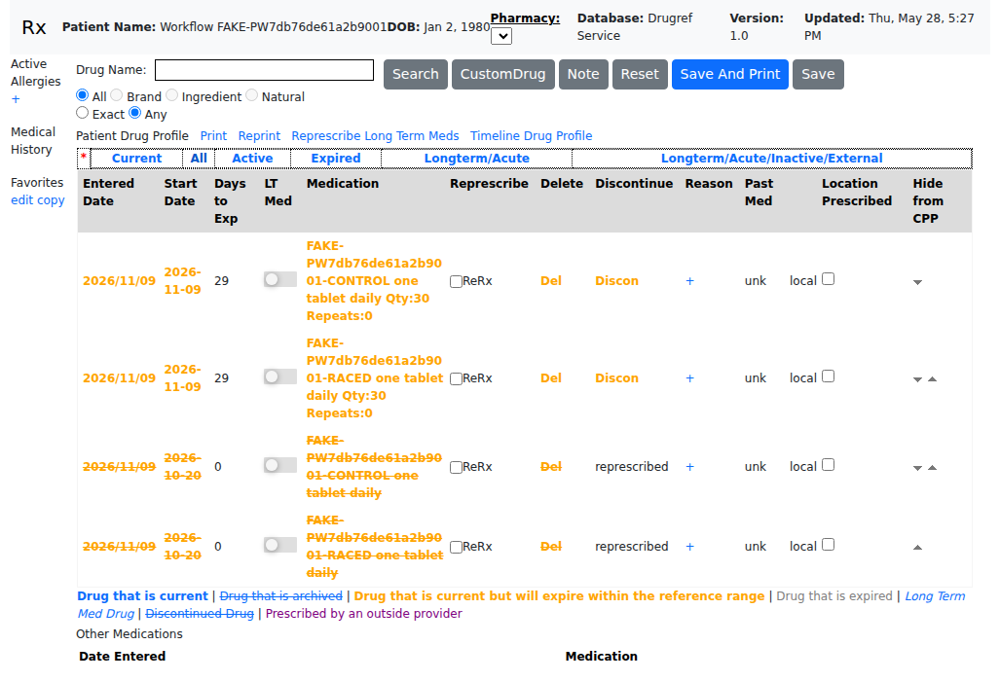
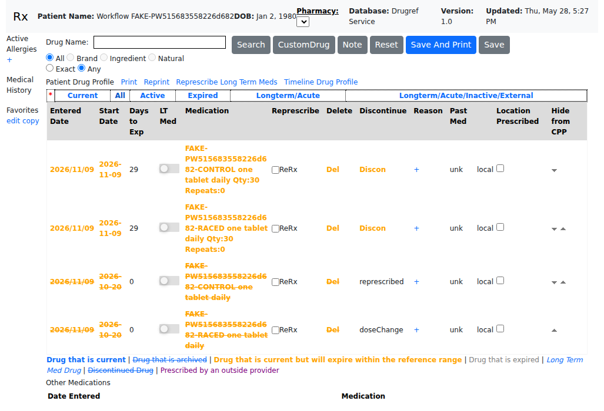

# Re-prescribing a source that another window already archived (#5987)

Rx profile, **All** view, after window A saved a re-prescription of two medications while
window B had discontinued one of them ("RACED", reason `doseChange`) between staging and save.
Captured by `scripts/concurrency-rx-represcribe-archived-source-playwright-checks.js` against
the packaged CARLOS build installed on an Ubuntu 26.04 container. Medication names are
synthetic fixtures for a `FAKE-` test patient.

| Before (develop) | After (this fix) |
|---|---|
|  |  |

- **Before:** the discontinued RACED source's reason was overwritten with `represcribed`
  (and its archived date replaced).
- **After:** the RACED source keeps `doseChange` and its own date; the untouched CONTROL source is
  still archived as `represcribed` by the same save, and each medication has exactly one new
  active copy.
