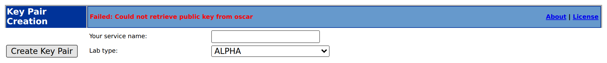
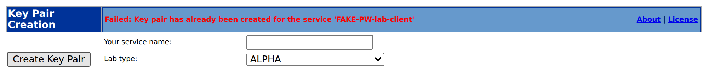
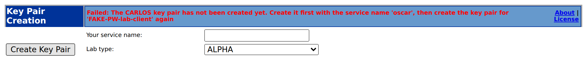
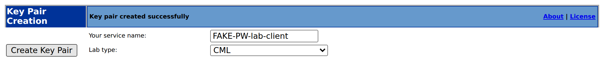

# PR #6112: Key Pair Creation stores nothing until the CARLOS key exists

Validated 2026-11-09 to 2026-11-10 (UTC) for
[issue #6009](https://github.com/carlos-emr/carlos/issues/6009) (release review
S18-P11, tracked in #5830), targeting `develop`.

## Deployment

- Packages built from source inside Ubuntu 26.04 (OpenJDK 25) with
  `dpkg-buildpackage -us -uc -b`, from this branch at `a4160f9fd5`:
  - `carlos-emr_2026.09.0~snapshot27_amd64`, including the pinned Chromium renderer
    (`debian/fetch-chromium.sh` checked both SHA256 pins);
  - `carlos-emr-drugref_2026.09.0~snapshot27_all`, built from the DrugRef pin
    `0d240f07ee5c32464060dd7eecd98f317b6b3a08`;
  - `carlos-ctl_1.2.2_all`, the pinned release asset (its published SHA256 checked).
- The CARLOS and DrugRef WARs were built first with the Maven flags `debian/rules` uses,
  then passed in as `CARLOS_WAR` / `DRUGREF_WAR`.
- The packaged `createKey.jsp` matches the source (SHA256 `336143c4…6a9f`).
- Fresh install into a disposable Ubuntu 26.04 systemd container with
  `scripts/deb-docker-validation.sh up`: Ontario, demonstration data, apt through an
  HTTPS-only egress proxy (`APT_FORCE_HTTPS=true`).
  - `carlos-ctl check` passed.
  - Every browser check went through the packaged front door
    (`https://127.0.0.1/carlos`, nginx with ModSecurity).
- The fresh install had no CARLOS key pair (`oscarKeys` 0 rows) and no client keys
  (`publicKeys` 0 rows). Every install starts in the state #6009 describes.

## Results

```sh
scripts/deb-docker-validation.sh suite --only admin-keygen-create-key-retry \
  --only admin-api-keygen --residue-audit
```

| Check | Fixed package | Pre-fix `createKey.jsp` swapped in |
|-------|---------------|------------------------------------|
| `admin-keygen-create-key-retry` (new) | **PASS**, 5/5 steps on all four runs, no residue | **FAIL** at "creating a client key is refused until the CARLOS key pair exists and stores nothing"; cleanup left no residue |
| `admin-api-keygen` | All steps pass except its pinned finding-163 step (`known-fail`, unchanged) | not run |

How the pre-fix page was put back: `createKey.jsp` from `develop` `4978962305` was swapped
into the installed webapp, its compiled class deleted, and CARLOS restarted with
`carlos-ctl restart`. Afterwards the fixed file was restored (hash checked) and the new check
passed again.

Two more runs of the new check:
- A repeat run passed: cleanup removes the CARLOS key pair it created.
- With a CARLOS key pair already present, the check reported **SKIP**, and the existing
  row was unchanged.

### The same three submissions, before and after

A driver submitted one fake service name, `FAKE-PW-lab-client`, three times: on an install
without the CARLOS key, then as `oscar`, then again.

| Step | Pre-fix | Fixed |
|------|---------|-------|
| 1. Client key, no CARLOS key | "Could not retrieve public key from oscar"; **`publicKeys` row stored** | "The CARLOS key pair has not been created yet…"; nothing stored |
| 2. `oscar` | CARLOS key pair created | CARLOS key pair created |
| 3. Same client name again | **"Key pair has already been created for the service"** | `keyPair.key` downloaded; one row stored |






## Other checks on the same install

- `lab-upload-signed-feed`, the other user of the CARLOS key pair: **PASS**, no residue.
- `--tier smoke`: 8 passed and 4 failed on the first run, and the residue audit flagged
  `measurementType` +63 and `validations` +14 rows (clinical measurement types seeded
  during the eChart checks).
  - Every one of the 4 failures was a 503 from `demographic/portalBookingPrompt`: no
    patient portal is configured on a disposable install.
  - With the `_portal.booking_prompt` grants restricted, as in
    [PR #5598](pr5598-validation.md), `appointment-lifecycle`, `browser-surface` and
    `echart` pass.
  - `document-upload` still fails on every run: an eChart left-navigation document link
    never becomes visible.
- The built WAR differs from one built from `develop` only in `KeyPairGen` (plus its two
  nested types), `createKey.jsp` and `buildNumber.properties`, compared entry by entry by
  CRC. So the `document-upload` failure and the residue do not come from this change.

## Re-validation after the review fixes (`05e926571c`)

The review pass changed application code: `ClientKeys` checks its own consistency, and a
failed create names the server log. So the packages were rebuilt at `05e926571c` the same way,
and installed fresh in a new container. The packaged `createKey.jsp` matches the source
(SHA256 `01dde8cc…ba30`), and the fresh install again had no CARLOS key pair.

- `admin-keygen-create-key-retry`: **PASS** 5/5, no residue.
- `admin-api-keygen`: all steps pass except its pinned finding-163 step (`known-fail`).
- `lab-upload-signed-feed`: **PASS**, no residue, once the `_portal.booking_prompt` grants
  were restricted. Before that it hit the same master-record portal 503 as above.
- A stored CARLOS row with a blank public key, driven through the page by an ad-hoc script:
  - the page shows "Failed: Could not create key pair. The server log records the cause";
  - no `publicKeys` row is stored;
  - the CARLOS journal holds one "The CARLOS key pair is stored without a public key" entry.

  The script then removed its row.

## Source-level tests

- `mvn test -Dtest='KeyPairGen*Test'`: 12/12 at `05e926571c` (11/11 before the review fixes added the result-consistency test).
  - `KeyPairGenCreateClientKeysIntegrationTest` uses the real DAOs and Spring
    transactions on H2 tables created from the Flyway baseline `CREATE TABLE` statements.
  - With the pre-fix order (store first) put back into `createClientKeys`, 7 of the 10
    new tests fail.
- `node --test scripts/admin-keygen-create-key-retry.test.js`: 4/4 (2 fail against the
  pre-fix JSP).
- `node --test scripts/playwright-suite-manifest.test.js`: 68/68.
